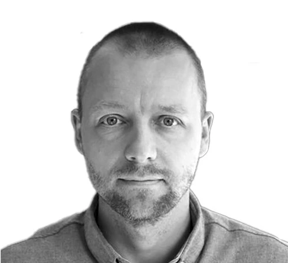
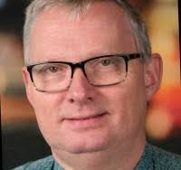
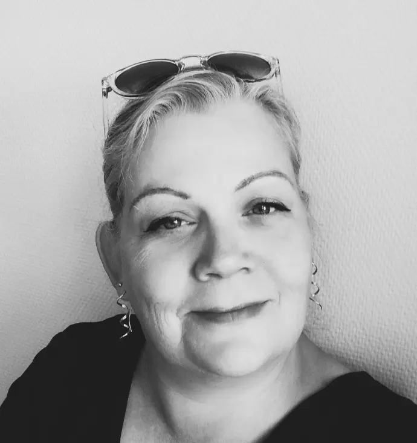
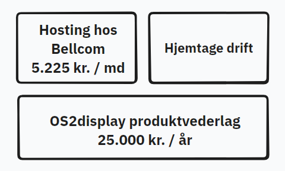

<!-- _class: cover -->

# OS2display webinar
### Produktdemonstration og planlagt M365-integration
22. oktober 2026 kl. 14 - 15:30

<!-- Note: Velkommen til OS2Display informationsmøde. Det koordinationsgruppen og produktforvaltning der er værter i dag. Vi har sammensat et bredt program hvor der både er noget for dem der er nysgerrige der bare vil se hvad OS2Display er for noget og så er der også programpunkter for garvede brugere fra leverandører og udviklere. Jeg har sat tider på dagsordenen som vi vil prøve at overholde. Det betyder at man kan gå til og fra alt efter hvad man er interesseret i.

Vi starter med at jeg fortæller om version 3 og fremtidsplanerne for produktet.

Dernæst går Dennis fra Bellcom på med en produktdemonstration for dem der gerne vil se brugergrænsefladen og hvordan man arbejder i systemet. Når Dennis viser frem vil jeg gerne have lov til at optage præcis den del, da vi kan bruge den som en videoguide til produktet.

Efter det vil Mads demonstrere kalenderskabelonen der pt. kun virker i Aarhus, men som en M365-dataintegration vil kunne udbrede til andre anvendere.
  -->

---

# OS2display produktfællesskabet

- Aarhus Kommune
- Ballerup Kommune
- København Kommune
- Køge Kommune
- Næstved Kommune
- Sønderborg Kommune
- Vejle Kommune

<blockquote>

“Fælles og solidarisk finansiering af vedligeholdelse, sikkerhed og videreudvikling af produktet”

</blockquote>

<!-- Note: 

Når kommuner og myndigheder tilslutter sig OS2Display betales en årligt produktvederlag. 

Det er via de midler vi finansiering af kodevedligehold og sikkerhedspatchning af systemet.  

Som medlem får man også mulighed for at deltage i arbejdsgrupperne og på den måde få direkte indflydelse på produktets styring og prioriteringer. Det er medlemskommunerne det ejer systemet og bestemmer over det. 

-->

---

# Organisering i OS2display

### Koordinationsgruppe

- Mads Agerbo Knude, Aarhus Kommune
- Mads Lykke, Aarhus Kommune
- Frederik Deth Hesselholt, Københavns Kommune
- Lars Kjær Lauridsen, Næstved Kommune
- Michael Walbum, Ballerup Kommune

### Produktforvalter 
Agnete Moos, Sønderborg Kommune (siden 1. januar 2026)

<!-- Note:

Lige nu ser vores koordinationsgruppe sådan ud og vi mødes en gang om måneden.

Det her arrangement er et godt eksempel på hvordan gruppen arbejder:
Michael Walbum fra Ballerup tager emnet med M365-integration op. Vi taler om det. Koordinationsgruppen beslutter at det skal undersøges nærmere og at en dialog med medlemmerne kunne være en god ide. Agnete indhenter tilbud fra ITK og får indkaldt til webinar. Mads Knude tilbyder at han godt kan lave en demo med kalenderslides fra Aarhus. Og på den måde er vi så her i dag.

Jeg er OS2display produktkoordinator og udlånt 8 timer om ugen til den opgave fra Sønderborg kommune.

I Sønderborg kommune sidder jeg med mange andre opgaver - herunder ansvar for ca. 60 infoskærme - så jeg har selv hånden på kogepladen hvis der er noget i systemet der ikke virker. 
 -->

---

# OS2display version 3

### Installation

- Installationspakke vedligeholdt af fællesskabet
- Interaktiv installationswizard til hurtigt demosite eller seriøs driftsinstallation
- Menubaseret systemadministration
- Grundig dokumentation vedr. drift og opdatering

### Udvikling:
- Nemmere at tilføje skabeloner og dataintegrationer 
- Enkel etablering af et udviklingsmiljø
- Omfattende teknisk udviklerdokumentation 

<blockquote>

Teknisk forenkling - tre komponenter samles i én

</blockquote>

<!-- Note:
Version 3 er først og fremmest en teknisk opgradering. OS2Display har indtil nu bestået af tre selvstændige serverkomponenter, der alle skulle installeres hver især på en server og så kommunikerer indbyrdes. Det er en kompliceret struktur, der har gjort drift og nyudvikling ret besværlig. 

Nu er tre komponenter smeltet sammen til en. Det giver os først og fremmest nogle konkrete fordele i forhold til installation, opdatering, systemadministration og featureudvikling.

Version 3 er simpelthen et tigerspring fremad i teknisk modenhed. Nogle af jer der har en hostet løsning tænker måske at det kan være ret lige meget for jer.

Men sagen er at det indtil nu ikke har givet mening at foreslå M365-integration, arrangementsplakater fra Folkebibliotekernes CMS, TopDesk-integration og hvad der ellers har hørt nævnt. Fordi det her med integrationer har været maks besværligt. Nu er det faktisk tilgængeligt. Version 3 er den trædesten der bringer os derhen hvor vi kan gå i gang med alt det sjove.

Jeg havde håbet i dag at kunne sige at nu er version 3 releaset, men vi er ikke helt i mål. Der er stadig nogle småting der mangler. Men det er meget lidt og det kører allerede nu på mange skærme i både Aarhus og Sønderborg og det kører godt.
-->

---
# Ny forvaltningsstruktur

<!-- Note: 
Version 3 er et led i en større strategi for en formel overdragelse af OS2Display fra Aarhus Kommune til OS2. Ikke kun kildekoden, men også forvaltningen af produktet. 

Det er ingen hemmelighed at Aarhus Kommune har været primus motor og hovedsponsor på OS2Display gennem alle årene. Systemet er født i Aarhus og udviklet af ITK. Det er udbredt til mange forvaltningsområder hvor det er stærkt forankret i arbejdsgange og opgaveløsning. Besøger man Dokk1 er der OS2 Display skærme overalt man kigger hen. 

Men nu er vi nået dertil at OS2display er klar til at flytte hjemmefra. Det er ikke sådan at vi går og smækker med døren. Vi lytter stadig og vil også gerne låne vaskemaskinen og have mad fra køleskabet indimellem. 

Men vi flytter - og vi har en tidslinje for det her. I skal ikke sætte jer ind i alle detaljer. Men bemærk at version 3 er en hjørnesten i hele overdragelsesprocessen. 
-->
---
# Ny styregruppe
<!-- _class: steering-group -->

### Thor Dekov Buur

Kontorchef i Kultur og Fritidsforvaltningen i Københavns Kommune. Medlem af OS2's bestyrelse.

### Per Kjær

Teamleder i Magistratsafdeling for Kultur og Borgerservice.

### Navn kommer senere

Sønderborg Kommune

<!--
Og hvor flytter vi så hen?

Vi flytter ind sammen med de her gutter. Det er Os2Displays nye styregruppe og det er dem der fremadrettet skal træffe de strategiske beslutninger for produktet og sikre produktets økonomi.

Det er så ny en gruppe at de ikke har haft lejlighed til at mødes endnu.
Kandidaten fra Sønderborg har vi navnet på men vedkommende skal lige først tiltræde i en ny stilling før det bliver offentligt.

En styregruppe på tre er lidt lille. Vi kunne godt bruge en eller to kandidater mere. Så hvis I sidder derude og tænker at vi godt kan give en hånd med, så vil vi gerne høre fra jer. Styregruppen mødes en gang om måneden og møderne har velfaciliteret med mødeledelse, referatskrivning osv. Det er overkommeligt at være med.

-->
---
# Konsulenthjælp fra OS2-sekretariatet

- Forvaltningsdokumentation
- Kontrakter
- Arbejdsgange

### Anna-Lis Berg

Anna-Lis er produktkonsulent og community builder i OS2's sekretariat i Aarhus. Hun arbejder blandt andet med organisatorisk onboarding af nye projekter og produkter.

---

# Produktøkonomi 

Pris pr. skærm pr. år for hosted Os2display løsning:

Ved 10 skærme: 8.770 kr.

Ved 60 skærme: 1.460 kr.

Ved 120 skærme: 730 kr.

Ved 500 skærme: 175 kr.

 <!--
 Nok om forvaltning. Inden Bellcom får ordet vil jeg  kort fortælle hvordan produktøkonomien omkring OS2Display ser ud i en mellemstor kommune som Sønderborg. 

  I Sønderborg Kommune er OS2display startet på biblioteket, kører nu også ude i nogle sportshaller hvor der vises banebooking via en integration til BRND. Næste skridt i Sønderborg bliver at brede systemet ud til folkeskoler og daginstitutioner.
 
 -->
 

