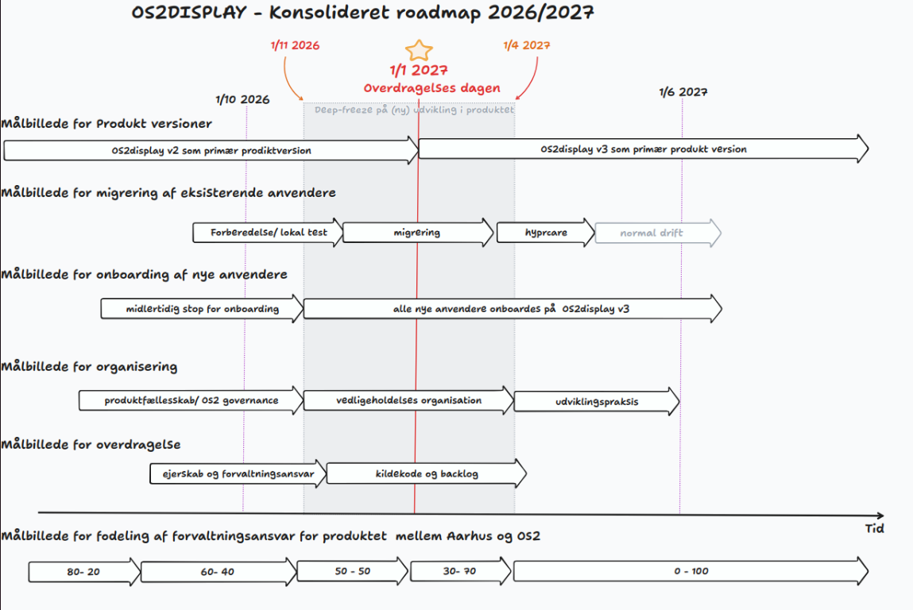

<!-- _class: cover -->

# OS2display webinar
### Produktdemonstration og planlagt M365-integration
22. oktober 2026 kl. 14 - 15:30

<!-- Note: Velkommen til OS2Display informationsmøde. Jeg har været spændt på fremmødet i dag, i forhold til PHP sårbarheden der blev fundet i går. Den er OS2display også ramt af og i går aftes har ITK udgivet nye images baseret på den patchede PHP version.

Ellers skal vi i gang med dagens program. Webinaret i dag er arrangeret af koordinationsgruppen og produktforvaltningen. Vi har sammensat et bredt program hvor der både er noget for dem der er nysgerrige der bare vil se hvad OS2Display er for noget og så er der også programpunkter for garvede brugere, og for leverandører og udviklere. Jeg har sat tider på dagsordenen som vi vil prøve at overholde. Det betyder at man kan zoome lidt ind og ud alt efter hvad man er interesseret i.

Jeg har de første to punkter hvor jeg  fortæller om version 3 og de fremtidsplaner vi har for produktet.

Efter det vil Dennis fra Bellcom gå på med en produktdemonstration for dem der gerne vil se brugergrænsefladen og hvordan man arbejder i systemet. Mens Dennis præsenterer vil jeg optage mødet for at kunne bryge det klip på vores produkthjemmeside. Så snart han er færdig med at præsentere stoppe jeg optalsen igen.

Efter det vil Mads demonstrere kalenderskabelonen der pt. kun virker i Aarhus, men som en M365-dataintegration vil kunne gøre anvendelig for alle andre også.
-->

---

# OS2display produktfællesskabet

- Aarhus Kommune
- Ballerup Kommune
- København Kommune
- Køge Kommune
- Næstved Kommune
- Sønderborg Kommune
- Vejle Kommune

<blockquote>

“Fælles og solidarisk finansiering af vedligeholdelse, sikkerhed og videreudvikling af produktet”

</blockquote>

<!-- Note:

Lihge nu er der 7 tilsluttede myndigheder til Os2display. De btaler et årligt produktvederlag for at være med.

Det er via de midler vi finansiering af kodevedligehold og sikkerhedspatchning af systemet. Apropos den aktuelle PHP-sikkerhedssag. Det er den slags produktvederlagt dækker.

Som medlem får man også mulighed for at deltage i arbejdsgrupperne og på den måde få direkte indflydelse på produktets styring og prioriteringer. Det er medlemskommunerne det ejer systemet og bestemmer over det.

-->

---

# Organisering i OS2display

### Koordinationsgruppe

- Mads Agerbo Knude, Aarhus Kommune
- Mads Lykke, Aarhus Kommune
- Frederik Deth Hesselholt, Københavns Kommune
- Lars Kjær Lauridsen, Næstved Kommune
- Michael Walbum, Ballerup Kommune

### Produktforvalter
Agnete Moos, Sønderborg Kommune (siden 1. januar 2026)

<!-- Note:

Os2Display har en koordinationsgruppe der mødes en gang om måneden. Koordinationsgruppen prioriterer odviklinhsønsker og beslutter hvilke nye features og funktionalitet der skal ind i systemet og hjælper med at løbe projekterne i gang. Webinaret er også et initiativ som koordinationsgruppen står bag.

Jeg er OS2displays produktkoordinator og udlånt 8 timer om ugen til OS2 fra Sønderborg kommune.

Jeg arbejder til daglig med forskellige opgaver - herunder ansvar for ca. 60 infoskærme - så jeg har selv hånden på kogepladen hvis der er noget i systemet der ikke virker.

Vi hoster desuden OS2Display selv på egne servere, så den del har jeg også hands-on erfaringer med.
-->

---

# OS2display version 3

### Installation

- Installationspakke vedligeholdt af fællesskabet
- Interaktiv installationswizard til opsætning af et hurtigt demosite eller rigtig driftsinstallation
- Menubaseret systemadministration
- Grundig dokumentation vedr. drift og opdatering

### Udvikling:
- Nemmere at tilføje skabeloner og dataintegrationer
- Enkel etablering af et udviklingsmiljø
- Omfattende teknisk udviklerdokumentation

<blockquote>

Teknisk forenkling - tre komponenter samles i én

</blockquote>

<!-- Note:
Os2display version 3. Det er sådan en stor opgradering der har været længe undervejs.Det er først og fremmest en teknisk opgradering. OS2Display har indtil nu bestået af tre selvstændige serverkomponenter, der alle skulle installeres hver især på en server og så kommunikerer indbyrdes. Det er en kompliceret struktur, der har gjort drift og feature-udvikling ret besværlig.

Nu er tre komponenter smeltet sammen til en. Det giver os først og fremmest nogle konkrete fordele i forhold til installation, opdatering, systemadministration og featureudvikling.

Version 3 er et ordentligt tigerspring når det gælder teknisk modenhed.

Mange af jer der lytter i dag er på en hostet løsning hos Bellcom, og tænker måske at det kan være ret lige meget for jer. Men sagen er den, at det indtil nu har været svært at starte projekter som M365-integration eller import af arrangementsplakater fra Folkebibliotekernes CMS, TopDesk-integration og hvad der ellers har hørt nævnt.

Fordi det her med integrationer har været ret besværligt. Nu er det faktisk tilgængeligt. Version 3 er den trædesten der bringer os derhen hvor vi kan gå i gang med alt det sjove.

Jeg havde håbet i dag at kunne sige at nu er version 3 releaset, men vi er ikke helt i mål. Der er stadig nogle småting der mangler. Men det er meget lidt og det kører allerede nu på mange skærme i både Aarhus og Sønderborg og det kører godt. Vi er fortrøstningsfulde og vi er maget snart i mål.
-->

---
# Ny forvaltningsstruktur

<!-- Note:
Version 3 er et led i en større strategi for en formel overdragelse af OS2Display fra Aarhus Kommune til OS2. Ikke kun kildekoden, men også forvaltningen af produktet.

Det er ingen hemmelighed at Aarhus Kommune har været primus motor og hovedsponsor på OS2Display gennem alle årene. Systemet er født i Aarhus og udviklet af ITK, der er Aarhus Kommunes interne udviklingsafdeling. I Aarhus er det udbredt til mange forvaltningsområder, hvor det er forankret i arbejdsgange og opgaveløsning. Hvis man tager til Dokk1. så er der OS2 Display skærme overalt man kigger hen.

Men vi er nu nået til at punkt hvor OS2display er klar til at flytte hjemmefra, hvis man ellers kan bruge sådan et billede. Det er ikke sådan at vi er uvenner med Aarhus og går og smækker med døren. Vi lytter stadig og vil nok også nogle gange have brug for at vi låne vaskemaskinen og have mad fra køleskabet indimellem.

Men vi flytter - og vi har en tidslinje for det her. I skal ikke sætte jer ind i alle detaljer. Men bemærk at version 3 er en hjørnesten i hele overdragelsesprocessen.
Og at vi har stort fokus på at anvenderne af systemet skal opleve uproblematisk overgang. Og det har vi et godt samarbejde med Bellcom omkring.
-->
---
# Ny styregruppe
<!-- _class: steering-group -->

### Thor Dekov Buur

Kontorchef i Kultur og Fritidsforvaltningen i Københavns Kommune. Medlem af OS2's bestyrelse.

### Per Kjær

Teamleder i Magistratsafdeling for Kultur og Borgerservice.

### Navn kommer senere

Sønderborg Kommune

<!--
Hvis vi skal blive i analogien om at flytte hjemmefra. Så kan man jo spørge: hvor flytter vi så hen?

Vi flytter ind sammen med de her gutter. Det er Os2Displays nye styregruppe og det er dem der fremadrettet skal træffe de strategiske beslutninger for produktet og sikre produktets økonomi.

Det er så ny en gruppe at de ikke har haft lejlighed til at mødes endnu. Vi har Thor fra København og Per fra Aarhus. Kandidaten fra Sønderborg har vi navnet på men vedkommende skal lige først tiltræde i en ny stilling før det bliver offentligt.

En styregruppe på tre personer, er lidt lille. Vi kunne godt bruge en eller to kandidater mere. Så hvis I sidder derude og tænker at vi godt kan give en hånd med, så vil vi gerne høre fra jer. Styregruppen mødes en gang om måneden og møderne har velfaciliteret med mødeledelse, referatskrivning osv. Det er overkommeligt at være med.

-->
---
# Konsulenthjælp fra OS2-sekretariatet

- Forvaltningsdokumentation
- Leverandørontrakter
- Arbejdsgange

### Anna-Lis Berg

Anna-Lis er produktkonsulent og community builder i OS2's sekretariat i Aarhus. Hun arbejder blandt andet med organisatorisk onboarding af nye projekter og produkter.

---

# Produktøkonomi i en kommune

Pris pr. skærm pr. år for hosted Os2display løsning:

Ved 10 skærme: 8.770 kr.

Ved 60 skærme: 1.460 kr.

Ved 120 skærme: 730 kr.

Ved 500 skærme: 175 kr.

<!--
Nok om forvaltning. Nu er det også snart der hvor Bellcom får ordet. men inden da har jeg et sidste slide, som hvor jeg taler som repræsentatant for Sønderborg Kommune. Jeg fortælle lidt om hvordan vi anskuer produktøkonomien omkring OS2Display i Sønderborg.

Sagen er den at en os2display løsning har en fast pris. produktvederlag  - og så skal man købe hosting.

Hvis man ganger og lægger sammen koster os2display løsning ca 89.000 kr på år. Det er lige meget hvor mange skærme man har. Den gode business case opstår hvis man har mange skærme.

I Sønderborg Kommune er OS2display startet på biblioteket, kører nu også ude i nogle sportshaller hvor der vises banebooking via en integration til BRND. Næste skridt i Sønderborg bliver at brede systemet ud til folkeskoler og daginstitutioner.

Vi prøver at rydde op i de infoskærmsløsninger der kører rundt omkring og arstatte dem med Os2display, så vi kan få en god og billig løsning.

-->

---
# Microsoft 365 integration

Estimat fra ITK: 100.000 - 150.000 kr.

For at være med skal man binde sig til at bidrage med mindst. 20.000 kr. - man må gerne bidrage med mere.

Pengene opkræves kun, hvis vi kan skaffe mindt 100.000 kr.

<!--
Nu har vi set de fine kalenderskabelon der ligger i OS2Display og hvardan de bliver brugt i Aarhus. Dem vil vi andre jo også gerne have mulighed for at bruge.

Men det kan vi kun hvis vi får bygget en dataforbindelse hvor vi kan hente kalenderdata fra M365.

Aarhus bliver på deres løsning og København i København har man ikke lov til at lave kalenderintegration i det hele taget pga. interne politikker så der er heller ikke interesserde. Så det er alle os andre i de mellemstore kommuner der må skaffe finaciering til det.

ITK har givet et estimat. Det relativt store spænd i estimatet dækker over at der kan være variation i hvordan en Microsoft Graph app er sat op i kommunerne og hvordan Outlook ressourcerne man gerne vil have vist, rent faktisk ser ud mht felter og lignende.

Hvis vi forbereder os grundigt og får afdækket den usikkerhed afdækket inden vi går i gang, så skulle 100.000 nok kunne række.

For dem der bidrager til finaciering, da tager vi hensyn til jeres setuo i udviklingsprocessen så vi sørger for at den løsning der udvikles kan fungerer i praksis hos jer.

-->
