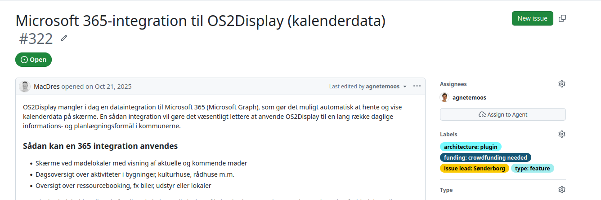
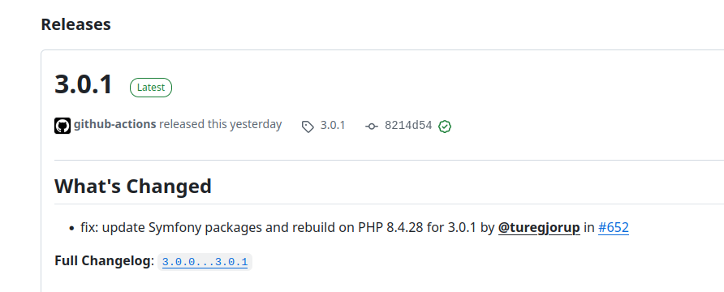
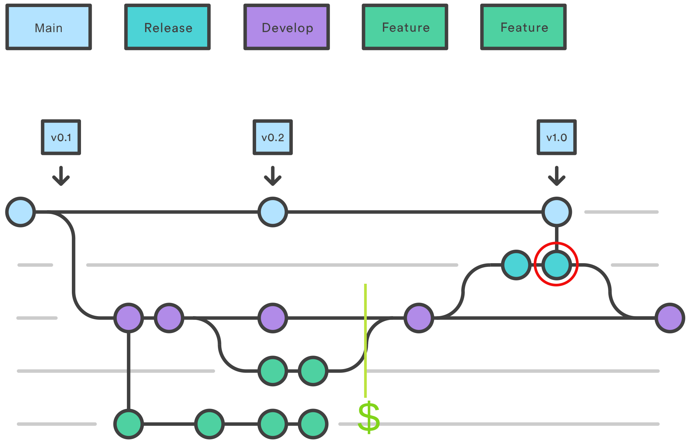

#  OS2display workshop den 23 november 2026

### Rammer for leverandørsamarbejde efter 1/1 2027

**DELTAGERE**
- ***Aarhus Kommune*** - Nuværende ejer af produktet
- ***OS2display produktforvaltningen*** - fremtidig ejere af produktet
- ***ITK-development v. Aarhus kommune*** - udviklings- og vedligeholdelsesleverandør
---
# Plan for dagen

- **10.00 - 10.15** : Introduktion og velkomst
- **10.15 - 11.30** : Session 1: Samarbejdsprincipper & Nøglebegreber
- **11.30 - 12.00** : ***Frokost på OS2's regning***
- **12.00 - 13.30** : Session 2 : Workflow & arbejdsprincipper
- **13.30 - 14.30** : Session 3 : Åben Teknisk workflow
- **14.30 - 15.30** : Session 4 : Forvaltningsmodel og leverandøraftaler
- **15.30 - 15:45** : ***Farvel og tak for i dag***
- 
---
# introduktion og velkomst

### Formål med dagen
Præsenter samarbejdsmodel, arbejdsrutiner og aftaleforhold efter formel overdragelse. 

### Udbytte af dagen:
En fælles forståelse af hvor der er tale om, *business as usual* , *Work in progress* eller nye krav & ændrede rutiner.

### Format & efterbehandling

- *Alle sessioner indledes med  formål, forventet udbytte og efterbehandling*
- *Alle sessioner optages med henblik på efterbehandling og referatskrivning*
---

## Session 1: Samarbejdsprincipper & Nøglebegreber

### Fokus: 
1. Rammer og hovedprincipper for samarbejde med OS2-fællesskabet
2. Nøglebegreber i samarbejdsmodellen

### Formål: 
ITKs nøglemedarbejdere får en forståelse af forløbet og hvad der forventes. OS2 får en forståelse af hvor der er diskrepans imellem leverandørens gældende praksis og den fremtidige samarbejdsmodel.

### Udbytte & efterbehandling
Der udarbejdes en punktliste over diskrepanser og forhold som vil kræve ekstra fokus i forbindelse med overgangen til den nye samarbejdsmodel.

---

---

# Rammer og hovedprincipper for samarbejde med OS2-fællesskabet / del 1

- Alt starter med et issue
- Alle issues er fra starten assigned til PO'en. 
- Alle issues/bidrag vurderes af PO ift. compliance med produktstrategien. 
- Det er styregruppe og koordinationsgruppe der beslutter produktstrategien på vegne af fællesskabet.
- Alle beslutninger dokumenteres i ADR / ODR / SDR
- ADR skal reviewes og godkendes af produktforvaltning

---

## Rammer og hovedprincipper for samarbejde med OS2-fællesskabet / del 2
- Ingen arbejder på opgaver der ikke har et Issue Lead 
- Sager uden Issue Lead er i backlog / on hold
- Ingen starter på opgaver før de er assignet
- Alle bidragsydere behandles principielt ens
- Alle bidrag skal gennem code review
- Der er forskellige review-krav til kodebidrag i hhv. core-zoner / plugin-zoner jvf. ADR
- Kodestandarder er klart defineret og integreret i CI-pipeline

---

## Rammer og hovedprincipper for samarbejde med OS2-fællesskabet / del 3
- PO assigner Issue Lead når issue vurderes compliant og tilstrækkelig beskrevet
- Issue Lead og deres leverandør aftaler det videre forløb
- Alt samarbejde foregår i GitHub for at opretholde transparens i samarbejdet
- Hele udviklingsforløbet samt review betales af Issue Lead
- Release betales af OS2 fællesskabet
  
---

# Nøglebegreber i samarbejdsmodellen
- Produktorganisering, Produkt fællesskab & Produktforvaltning
- Contributor - Bidragsyder
- Issues, Issue Lead & Assignee
- Architecture, Core vs plugin & Releases

---

# Produktorganisering

---

#  Produktfællesskabet

- Produktfællesskabet er selvfinansieret og selvstyrende
- Medlemmer af Produktfællesskabet kan deltage i produktets koordinations- og styregruppe
- Styregruppen har fokus på økonomi, strategi og organisering
- Koordinationsgruppen har fokus på vedligehold, videreudvikling og udbredelse.
- Produktets styrende organer delegerer den daglige håndtering af fællesskabets aktiviteter til et produktsekretariat, en produktkoordinator eller en Product owner

[https://www.os2.eu/arbejdsgrupper](https://www.os2.eu/arbejdsgrupper)

---

# Produktforvaltningen

### Produktforvaltning som begreb omfatter flg:
- Administration, kommunikation, budget og regnskab 
- Community building og Crowdfunding 
- Vedligehold & videreudvikling af kildekoden 
- Git organisering, automatisering og maintenance

### Produktforvaltning i en OS2 kontekst  
Produktets styrende organer udpeger en eller flere produktforvaltere til at styre produktets daglige aktiviteter.

Produktforvalterne har til opgave at sikre at disse aktiviteter afvikles som anvist af produktets styrende organer og i henhold til OS2' governancemodel.

---

# Contributor - Bidragsyder
### Bidrag - det brede begreb. 
Mads K.s oplæg på webinar. SSO-vejledning fra Køge. Når Ballerup stiller sig forrest i en crowdfunding. Når Mads Lykke og Anders Gejl brugertester. Jeg vil arbejde på at alle medlemmer af OS2-fællesskabet bliver bidragsydere.

### Bidrag - det smalle begreb. 
Pull request til os2display/os2display og os2display/os2display-docker-server

---

## Hvem er bidragsydere lige nu?
- ITK i udviklingsleverandørrollen
- Bellcom/København
- Agnete/Sønderborg

### Principper for bidragsydere
- Alle bidragsydere behandles ens. 
- Det er samme retningslinjer og arbejdsgange der gælder for alle.

---

# Eksempel GitHub Issue

---

# Issue Lead

- Issue Lead kan være en myndighed eller OS2display-fællesskabet
- Issue Lead assigneres på en sag af PO når opgaven er tilstrækkelig beskrevet og vurderes compliant med produktstrategien
- Issue Lead indgår aftale med leverandør og er ansvarlig for fremdrift i sagen
- Issue Lead aftaler og betaler code review
- Issue Lead brugertester releasekandidater, hvori der indgår bidrag fra dem

---

# Assignee

- Den der skal tage næste skridt / Den vi afventer input/handling fra.
- Hvis vi bruger Assignee bliver det nemmere for os hver især, at få øje på det vi skal forholde os til.
- Lige nu tagger vi. Det er fint nok som en orientering - men ikke som opgavedelegering.

---

# Architecture core/plugin (work in progress)

- Et issue godkendes til udvikling i hhv. core-zone/plugin-zone. Det scope skal overholdes.

- Der er lempeligere krav for genbrugelighed til kodebidrag i plugin-zoner jvf. ADR. 
- Plugin-zone kode skal kunne deaktiveres fuldstændig. 

- Alle contributors kan bidrage til både core-zoner og plugin-zoner 

---

# Release

- Release = tagging af en ny version på GitHub.
- Release har ikke noget med idriftsætning at gøre.
- OS2display produktforvaltningen ønsker at indgå aftale med vedligeholdelsesleverandør om månedlige releases

---
# Frokost
---

# Session 2:Workflow & arbejdsprincipper / slide 1

### Fokus
- Samarbejdsmodel og arbejdsflow
- Gitflow
- Releaseproces
- Contribution flow
- Brugerinvolvering og brugertest
  
### Formål
Leverandørens nøglemedarbejdere får en forståelse af OS2displays tekniske forvaltningsmodel fremover.
OS2display får leverandørens input til hvordan man operationaliserer den tekniske forvaltningsmodel.

---

## Session 2:Workflow & arbejdsprincipper / slide 2

### Udbytte og efterbehandling
De konkrete input til operationalisering af den fremlagte samarbejdsmodel, dokumentere, så man efterfølgende kan anvende disse til en yderligere konkretisering af forvaltningsdokumentationen.

---

# Samarbejdsmodel og arbejdsflow

---

# Rammesætning af samarbejdet

---

# Gitflow

---

# Code review

- Vedligeholdelsesleverandør skal kunne tilbyde code review ydelse
- Tidspunkt og pris for code review aftales mellem Issue Lead og vedligeholdelsesleverandør
- Code review betales af Issue Lead
- I tvivlsspørgsmål eller ved uenighed kan begge parter vælge at inddrage PO
- Code review skal foregå på GitHub for at sikre transparens

**Spørgsmål**

- Hvor stopper code review og hvor starter releaseproces? (Merge til develop?)
- Har vi brug for en code review kontrakt-skabelon?

---

# Releaseproces der kører hver måned.
Vedligeholdelsesleverandøropgave betalt af OS2-fællesskabet

### Dag 1 (f. eks. 2. onsdag i måneden)
- Undersøge om der ligger unreleased changes i develop
- Hvis der er - oprette RC1-branch 
- Sætte RC1-branch i drift på OS2 testserver
- PO meddeler berørte Issue Leads om at de nu skal brugerteste
- Release evt. RC2 fra forrige cyklus, ved positivt svar fra brugertests

---

### Dag 14 (f. eks. 4. onsdag i hver måned)
PO sender svar fra RC1-brugertest til vedligeholdelsesleverandør
- **Positivt svar** fra brugertest = Release tagges på dag 14
- **Intet svar** fra brugertest = Hvad er bedst ???
- **Negativt svar** fra brugertest = Defekt feature fjernes fra develop og tilbage i feature-branch. Nyt code review påkrævet.
- **Positivt svar + negativt svar** fra brugertests: Defekt feature fjernes fra develop og tilbage i feature-branch. RC2 tagges med features der havde positivt svar. RC2 sættes i drift på OS2 testserver. PO meddeler berørte Issue Leads om at de nu skal brugerteste RC2.

---

### Brugerinvolvering og brugertest 

OS2display har brug for en testserver. Den skal anvendes til test af releasekandidater.

Det skal være en effektiv automatiseret løsning, der ikke kræver en masse håndholdt arbejde.

---

# Session 3: Åben Teknisk workshop

### Fokus
Identificerede steder i gitflowet og arbejdsmodellen, hvor der er behov for yderligere uddybning af hvorledes disse implementeres teknisk.

### Formål
Dybere teknisk afklaring af de daglige rutiner omkring vedligehold.

### Udbytte og efterbehandling
Detaljeforslag til operationalisering af vedligeholdelsesforpligtelsen dokumenteres, således at de efterfølgende kan bruges til uddybning af forvaltningsdokumentation og udarbejdelse af leverancebeskrivelse for vedligehold.

---

# Åbn teknisk workshop
Elaborering om Gitflow, Release, Brugertest

---

# Session 4: rammesætning af den fremtidige forvaltningsmodel / slide 1

### Fokus
Rammesætning af fremtidig forvaltningsmodel i forhold til 
- Roller og ansvar
- beslutningsgange og forvaltningsprincipper

Rammer og mål for etablering af leverandøraftaler efter overtagelse.
- kontrakt struktur og leverancemodel
- afregningspraksis

---

## Session 4: rammesætning af den fremtidige forvaltningsmodel / slide 2

### Formål 
Vi etablerer grundlaget for at påbegynde udarbejdelse af samarbejdsaftaler på både kort og lang sigt. 

### Udbytte og efterbehandling
Der etableres et fælles sprog og en gensidig forståelse af muligheder og begrænsninger i forbindelse med aftaleindgåelse, hvorefter OS2 kan påbegynde udfærdigelse af de aftaler der skal etableres i forbindelse med overdragelsen.

---

##  Roller og ansvar 1

### Leverandørroller
- Vedligehold
- Udvikling
- Drift

### OS2 roller
- Git maintainer

### Anvenderroller
- Issue Lead
- PO / Produktkoordinator (SPOC)
- Driftleverandør

---

##  Roller og ansvar 2

---

# Beslutningsgange og forvaltningsprincipper

---

# Afregningspraksis

---

# Kontrakt struktur og leverancemodel 

---

# Farvel og tak for i dag

---

