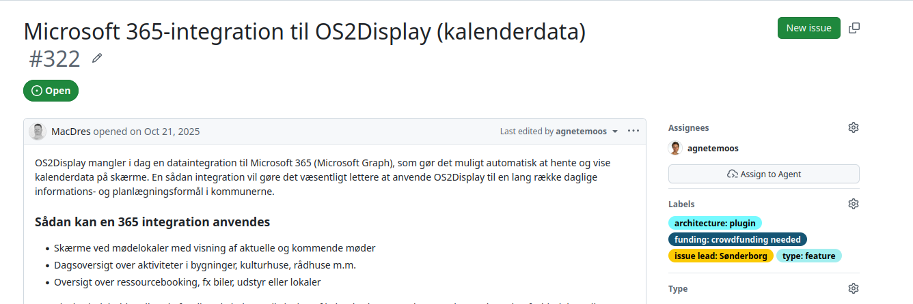
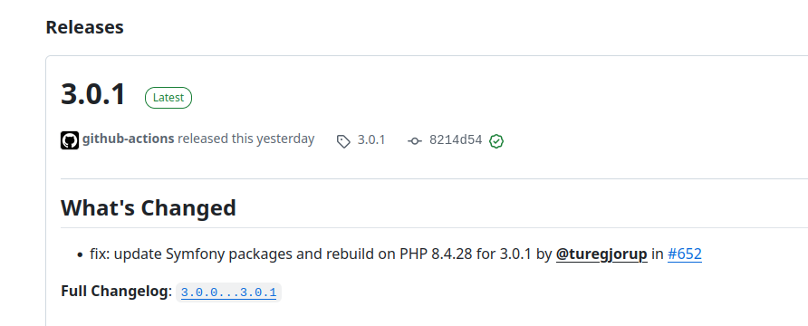
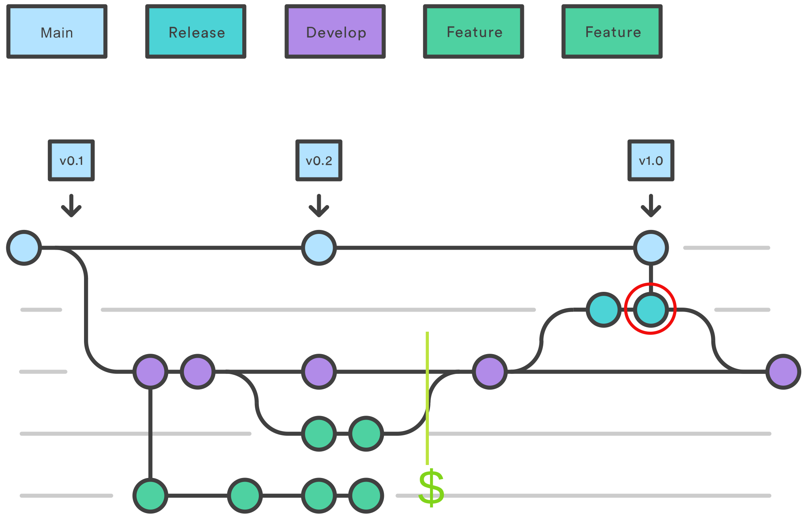

# Plan for dagen

### Introduktion og rammesætning

### Dagsorden

### Referat

---
# Session 1

### Formål: 
ITKs nøglemedarbejdere får en forståelse af forløbet og hvad der forventes. OS2 får en forståelse af hvor der er diskrepans imellem leverandørens gældende praksis og den fremtidige samarbejdsmodel.

### Udbytte: 
Punktliste over diskrepanser

### Efterbehandling: 
Håndtere diskrepans

---

---

# Rammer og hovedprincipper for samarbejde med OS2-fællesskabet / del 1

- Alt starter med et issue
- Alle issues er fra starten assigned til PO'en. 
- Alle issues/bidrag vurderes af PO ift. compliance med produktstrategien. 
- Det er styregruppe og koordinationsgruppe der beslutter produktstrategien på vegne af fællesskabet.
- Alle beslutninger dokumenteres i ADR / ODR / SDR
- ADR skal reviewes og godkendes af produktforvaltning

---

# Rammer og hovedprincipper for samarbejde med OS2-fællesskabet / del 2
- Ingen arbejder på opgaver der ikke har et Issue Lead 
- Sager uden Issue Lead er i backlog / on hold
- Ingen starter på opgaver før de er assignet
- Alle bidragsydere behandles principielt ens
- Alle bidrag skal gennem code review
- Der er forskellige review-krav til kodebidrag i hhv. core-zoner / plugin-zoner jvf. ADR
- Kodestandarder er klart defineret og integreret i CI-pipeline

---

# Rammer og hovedprincipper for samarbejde med OS2-fællesskabet / del 3
- PO assigner Issue Lead når issue vurderes comliant og tilstrækkelig beskrevet
- Issue Lead og deres leverandør aftaler det videre forløb
- Alt samarbejde foregår i GitHub for at opretholde transparens i samarbejdet
- Hele udviklingsforløbet samt review betales af Issue Lead
- Release betales af OS2 fællesskabet

---

# Nøglebegreber i samarbejdsmodellen

### Produktforvaltningen (xxx Anna-Lis kommer med forklaring)

### Produktets styrende organer (xxx Anna-Lis finder billede)

---

# Contributor - Bidragsyder
### Bidrag - det brede begreb. 
Mads K.s oplæg på webinar. SSO-vejledning fra Køge. Når Ballerup stiller sig forrest i en crowdfunding. Når Mads Lykke og Anders Gejl brugertester. Jeg vil arbejde på at alle medlemmer af OS2-fællesskabet bliver bidragsydere.

### Bidrag - det smalle begreb. 
Pull request til os2display/os2display  og os2display/os2display-docker-server

---

### Hvem er bidragsydere lige nu?
- ITK i udviklingsleverandørrollen
- Bellcom/København
- Agnete/Sønderborg

### Principper for bidragsydere
- Alle bidragsydere behandles ens. 
- Det er samme retningslinjer og arbejdsgange der gælder for alle.

---

# Eksempel Github Issue

---

# Issue Lead

- Issue Lead kan være en myndighed eller OS2display-fællesskabet
- Issue Lead assignes på en sag af PO når opgaven er tilstrækkelig beskrevet og vurderes compliant med produktstrategien
- Issue Lead indgår aftale med leverandør og er ansvarlig for fremdrift i sagen
- Issue Lead aftaler og betaler code review
- Issue Lead brugertester releasekandidater, hvori der indgår bidrag fra dem

---

# Assignee

- Den der skal tage næste skridt / Den vi afventer input/handling fra.
- Hvis vi bruger Assignee bliver det nemmere for os hver især, at få øje på det vi skal forholde os til.
- Lige nu tagger vi. Det er fint nok som en orientering - men ikke som opgavedelegering.

---

# Architecture core/plugin (work in progress)

- Et issue godkendes til udvikling i hhv. core-zone/plugin-zone. Det scope skal overholdes.

- Der er lempeligere krav for genbrugelighed til kodebidrag i plugin-zoner jvf. ADR. 
- Plugin-zone kode skal kunne deaktiveres fuldstændig. 

- Alle contributors kan bidrage til både core-zoner og plugin-zoner 

---

# Release

- Release = tagging af en ny version på GitHub.
- Release har ikke noget med idriftsætning at gøre.
- OS2display produktforvaltningen ønsker at indgå aftale med vedligeholdelsesleverandør om månedlige releases

---
# Frokost
---

# Session 2

### Formål

Leverandørens nøglemedarbejdere får en forståelse af OS2displays tekniske forvaltningsmodel fremover.
OS2display får leverandørens input til hvordan man operationaliserer den tekniske forvaltningsmodel.

### Udbytte
Konkret input til operationalisering

### Efterbehandling
Forvaltningsdokumentation konkretiseres yderligere. 

---
# Samarbejdsmodel og arbejdsflow
XXX Billede

---

# Rammesætning af samarbejdet

Hvad samarbejder OS2 med ITK om?

# Aftaler OS2display
xxx indsæt billede

---

# Gitflow

---

# Code review

- Vedligeholdelsesleverandør skal kunne tilbyde code review ydelse
- Tidspunkt og pris for code review aftales mellem Issue Lead og vedligeholdelsesleverandør
- Code review betales af Issue Lead
- I tvivlsspørgsmål eller ved uenighed kan begge parter vælge at inddrage PO
- Code review skal foregå på GitHub for at sikre transparens

**Spørgsmål**

- Hvor stopper code review og hvor starter releaseproces? (Merge til develop?)
- Har vi brug for en code review kontrakt-skabelon?

---

# Releaseproces der kører hver måned.
Vedligeholdelsesleverandøropgave betalt af OS2-fællesskabet

### Dag 1 (f. eks. 2. onsdag i måneden)
- Undersøge om der ligger unreleased changes i develop
- Hvis der er - oprette RC1-branch 
- Sætte RC1-branch i drift på OS2 testserver
- PO meddeler berørte Issue Leads om at de nu skal brugerteste
- Release evt. RC2 fra forrige cyklus, ved positivt svar fra brugertests

---

### Dag 14 (f. eks. 4. onsdag i hver måned)
PO sender svar fra RC1-brugertest til vedligeholdelsesleverandør
- **Positivt svar** fra brugertest = Release tagges på dag 14
- **Ingen svar** fra brugertest = Hvad er bedst ???
- **Negativt svar** fra brugertest = Defekt feature fjernes fra develop og tilbage i feature-branch. Nyt code review påkrævet.
- **Positivt svar + negativt svar** fra brugertests: Defekt feature fjernes fra develop og tilbage i feature-branch. RC2 tagges med features der havde positivt svar. RC2 sættes i drift på OS2 testserver. PO meddeler berørte Issue Leads om at de nu skal brugerteste RC2.

---

### Contribution flow - Nøgletegning

---

### Brugerinvolvering og brugertest 

OS2display har brug for en testserver. Den skal anvendes til til test af release kandidater.

Det skal være en effektiv automatiseret løsning, der ikke kræver en masser håndholdt arbejde. 

---

# Session 3

### Formål
Dybere teknisk afklaring af de daglige rutiner omkring vedligehold.

### Udbytte
Detaljeforslag til operationalisering af vedligeholdelsesforpligtelsen

### Efterbehandling
Uddybning af forvaltningsdokumentation. Udarbejdelse af leverancebeskrivelse for vedligehold.

---

# Åbn teknisk workshop
Elaborering om Gitflow, Release, Brugertest

---

# Session 4
# Rammesætning af fremtidig forvaltningsmodel
- Roller og ansvar
- Beslutningsgange og forvaltningsprincipper

